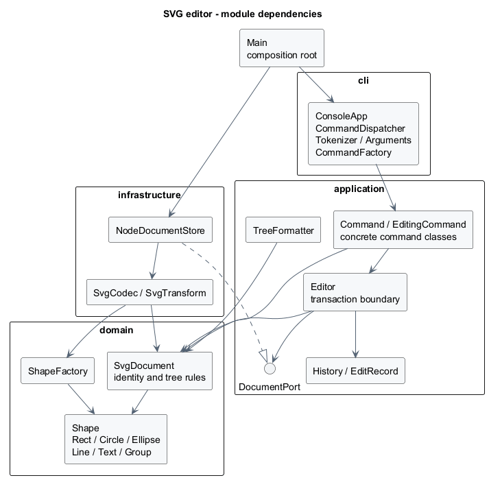

# PJ1 Phase 1：SVG 编辑器（CLI）

这份实现对应 `phase_cli_1.md`。我把重点放在三件事上：图形和容器能够用同一套接口操作；一条命令对应一个完整的历史单元；失败时文档、文件路径和撤销栈都保持原样。代码使用 TypeScript，运行环境为 Node.js 22 及以上。

## 架构方案

### 模块划分

| 目录 | 职责 | 主要类 |
|---|---|---|
| `src/domain/` | 图形的几何行为、属性约束、文档树与唯一 id | `Shape`、五种叶子图形、`Group`、`SvgDocument`、`ShapeFactory` |
| `src/application/` | 编辑事务、历史、文档操作和显示结果 | `Editor`、`History`、`EditRecord`、`TreeFormatter`、`DocumentPort` |
| `src/application/commands/` | 保存请求参数，调用接收者 | 各具体 `Command`；编辑类继承 `EditingCommand` |
| `src/cli/` | 分词、参数检查、命令构造和 REPL | `Tokenizer`、`Arguments`、`CommandFactory`、`CommandDispatcher`、`ConsoleApp` |
| `src/infrastructure/` | XML 转换和真实文件读写 | `SvgCodec`、`SvgTransform`、`NodeDocumentStore` |
| `src/Main.ts` | 装配上述对象，选择标准输入或脚本输入 | 无业务规则 |

下面是主要依赖关系。图源是 [architecture.puml](architecture.puml)，可以用 PlantUML 重新生成。



图形持有私有字段并提供行为。外部拿到的属性表、子节点数组以及 `Editor.inspect()` 返回的文档都是副本，不能靠修改返回值绕过编辑事务。

### 设计模式的选择

**Command 是请求的边界。** 课件 `command.pdf` 第 11—12、16—17 页强调：具体命令绑定接收者，实际业务留在接收者中。我据此安排了这些角色：

| Command 角色 | 本项目中的位置 |
|---|---|
| Command | `Command.execute()`；`EditingCommand` 统一进入编辑事务 |
| ConcreteCommand | `MoveCommand`、`GroupCommand`、`SaveCommand` 等 |
| Client | `CommandFactory` 根据参数构造命令并绑定 `Editor` |
| Invoker | `CommandDispatcher` 调用命令；REPL 只负责读入和输出 |
| Receiver | `Editor` 管理当前文档；草稿上的 `SvgDocument` 和 `Shape` 执行树操作、几何运算 |

例如，`MoveCommand` 不知道矩形有哪些坐标，也不判断目标是不是容器。它只在草稿上定位对象并调用 `move(dx, dy)`。真正的计算在图形类中，文件操作则在注入的 `DocumentPort` 实现中。

**Composite 解决“图形里还有图形”。** 课件 `composite.pdf` 第 10—14 页给出的关键点是：容器的子节点仍然是 Component，递归落在容器的操作中。本项目的 `Group` 继承 `Shape`，内部保存 `Shape[]`；`move` 和 `scale` 转发给直接子节点，由子节点继续递归。叶子负责自己的几何属性，不存在一张按 tag 分派移动逻辑的大表。

结构管理采用课件第 14 页讨论的安全式接口：只有 `Group` 提供 `add/remove`。因此 `in`、`addto`、`ungroup` 会检查容器能力；普通移动、缩放和属性命令不区分叶子与容器。`set g fill red` 设置组的 SVG 继承属性，不把颜色强行写进所有后代。

**撤销采用 Command 加文档快照。** 课件第 22—25 页的两个栈决定了历史如何流转。本项目仍按这个规则管理历史，但用 `EditRecord` 保存前后文档，撤销和重做恢复快照，而不重新解析输入或执行浮点逆运算：

1. 复制当前文档，得到一次编辑专用的草稿。
2. 在草稿上执行命令，并校验唯一 id、无环和无共享子节点等约束。
3. 全部成功后替换当前文档，将前后快照记入 undo 栈，清空 redo 栈。
4. 任何一步失败，丢弃草稿，已有文档与两栈都不动。

这样 `group`、删除子树、跨容器移动都能成为一个 undo 单元。代价是一次编辑需要 O(N) 复制，保留 K 次历史约占 O(KN) 空间。我认为这适合当前规模；若以后处理大型图纸，再改为局部差量记录，不急着给本阶段引入复杂的补偿操作。

### 依赖方向规则

- `domain` 只能依赖自身，不导入 Node 文件 API、XML 库或命令行类。
- `application` 可以依赖 `domain`；它定义 `DocumentPort`，不引用具体存储实现。
- `cli` 调用 `application`，并复用 `domain/Numbers` 做数值解析。它不直接改图形树。
- `infrastructure` 实现 `application` 的端口，使用 `domain`，允许依赖 Node 与 XML 库。
- `Main` 是装配根，可以创建各层对象。

按名称分派集中在两处：`CommandFactory` 的命令登记表、`ShapeFactory` 的六种图形登记表。**这两处是后续插件化的待重构点**，不是本阶段已经实现的插件系统。新增图形时应扩展图形登记表和具体类，不在移动、树显示或序列化中增加 `switch(tag)`。

### 变化点假设

| 可能的变化 | 目前的安排 |
|---|---|
| 增加 GUI 或代理入口 | 直接构造命令对象；不把 REPL 或文本分词带入业务层 |
| 增加 `box` 等图形插件 | 保留 Shape 多态接口；下一阶段把工厂登记改为外部注册，并明确复合图形的属性传播与解组限制 |
| 更换 XML 库或改用其他存储 | XML 转换集中在 `SvgCodec`；业务只依赖 `DocumentPort` |
| 文件变大、历史变长 | 可以用差量记录替换 `EditRecord`；当前先保留容易核对的完整快照 |
| 支持完整 SVG/CSS | 当前明确接受受支持的图形和属性；不把无法解释的元素悄悄丢掉。完整 CSS、路径和任意变换另做范围设计 |

## 过程记录

本次通过 Codex 协作完成实现。我在整理方案时没有只给出“写一个 SVG 编辑器”的笼统目标，而是把附件里的约束、边界和具体会话一起作为输入。以下记录按实际实现与验证整理，提交时间均保留真实时间。

### 先把教材里的分工落实到对象

我先对照 `command.pdf` 中从“逻辑写在入口”到“入口委托命令、命令调用 receiver”的重构过程，确定命令类只搬运参数和转发操作。树结构的合法性放在 `SvgDocument`，几何计算放在各图形类。否则，即使类叫 `MoveCommand`，里面仍然可能是一串按图形类型分支的过程式代码。

组合模式也作了同样的检查：我用三层容器和一个矩形测试整体移动、缩放，确认容器递归调用子节点，而不是在命令层扫描所有叶子。这对应 `composite.pdf` 第 12—13 页的递归和“容器能否出现在子节点位置”的判据。

### 用失败场景约束历史设计

我先为命令层写了撤销、分支重做、IO 屏障和失败回滚的测试，再补实现。首次运行因 `Editor`、`CommandDispatcher` 和文件端口尚未实现而编译失败；实现后这批测试与领域测试共 11 项通过。这一段采用了 `tdd.pdf` 第 4—12 页的“先明确可执行规格，再实现”的思路；领域模型的第一轮则是模型与测试一起完善，并不把整个开发过程都描述成严格测试先行。

一个容易漏掉的场景是：组内第一个图形缩放成功，第二个图形因为数值溢出失败。如果直接修改当前文档，返回错误也已经来不及恢复前一个图形。我把这个情形写入 `editor.test.ts`，要求失败后整棵树和上一次可撤销操作都不变，因此采用“草稿成功后提交”的编辑方式。

另一个约定是 `save` 成功后连 `redo` 也要禁止，而 `canvas` 不带参数只是显示，不能清除历史。我分别测试了成功 IO、失败 IO、显示命令和下一次成功编辑，避免把它们一概处理成清空栈。

### 补齐外部 SVG 的边界

读入时不能见到第一个缺 id 的矩形就直接叫它 `rect1`：后面可能有一个显式命名的 `rect1`。我采用先收集整份文档的显式 id、再分配缺失 id 的两遍处理，测试中也故意把显式 id 放到后面。

附件背景中用了嵌套的 `translate(...) scale(...)`。读入后我将支持的变换归一化到叶子坐标，同时换算受缩放影响的文字字号和线宽，保证这些示例的显示效果。不能支持的旋转、错切和非等比变换明确报错，避免保存后悄悄改变图。

接入 XML 库时，严格类型检查指出 `Element.localName` 可空；我补上了 `tagName` 分支。之后标准会话测试出现 `detached shape: box`，定位发现是测试从两个不同的 `inspect()` 副本中混取对象。修正为在同一快照上找对象和父节点，保留文档的对象归属检查，而不是放松模型约束。

### 分步提交

| 提交 | 对应阶段 |
|---|---|
| `7782826` | 建立工程和架构约束 |
| `7e5737c` | 六种图形、嵌套树结构、领域测试 |
| `be06cf4` | 命令调度、事务式编辑、undo/redo |
| `f17d1db` | SVG 文件读写、完整 CLI、题目会话与边界测试 |
| 后续文档提交 | 补齐教材对应、架构图、使用方法和交付检查 |

这些提交对应实际完成的阶段；最终版本由 `final` 标签定位。

## 一致性自查

**目录与方案一致。** 实际保留了 domain、application、cli、infrastructure 四个模块。`commands/` 是 application 内部子目录，不增加新的跨层关系。实现时把历史中的快照抽成 `EditRecord`，把 SVG 变换解析抽成 `SvgTransform`；两处细化均已反映在上面的模块表和图中。

**依赖方向已检查。** `scripts/check-architecture.mjs` 检查源文件的相对导入、领域/应用层外部依赖、一类一文件和额外的 switch 分派。本次检查通过，共检查 123 条相对导入。抽样核对如下：

| 文件 | 实际依赖 | 结论 |
|---|---|---|
| `domain/Group.ts` | Shape、Numbers | 递归操作不依赖命令或 IO |
| `application/Editor.ts` | SvgDocument、DocumentPort、History、EditRecord | 业务依赖端口，没有导入 fs |
| `application/commands/MoveCommand.ts` | EditingCommand、Editor、SvgDocument | 无图形类型判断和几何公式 |
| `infrastructure/NodeDocumentStore.ts` | DocumentPort、SvgCodec、Node 文件 API | 文件操作集中在适配器 |
| `cli/CommandDispatcher.ts` | Tokenizer、CommandFactory、Editor | 解析与错误边界不进入模型 |

这个脚本只是静态规则检查，不替代职责审查。例如“类中是否放了过多逻辑”仍要读代码判断。当前明确保留的重构点是两个工厂的内置登记表和完整快照的空间开销。

## 功能完整性与质量保证手段

### 对照题目验收

| 要求 | 验证位置 |
|---|---|
| 六种类型、浮点与负坐标、大小写敏感 id | `domain.test.ts`、`requirements.test.ts` |
| 所有 create 参数、可选颜色、所有类型的 in | 工厂与命令测试；两组题目脚本 |
| delete/move/scale/set 对叶子和容器的统一操作 | `editor.test.ts` 的所有编辑命令往返；嵌套与溢出测试 |
| group/addto/ungroup、祖先环拒绝、保持顺序 | `domain.test.ts`、`requirements.test.ts` |
| 同级 front/back 与原位置恢复 | `requirements.test.ts` |
| 一命令一撤销、新编辑清 redo、失败不清 redo | `editor.test.ts` |
| init/read/save/canvas 修改后的历史屏障 | `editor.test.ts`、默认文件路径测试 |
| tree 内联几何属性、show 父级、help | 两组脚本及命令测试 |
| 缺 id 自动分配、后置显式 id 冲突 | `svg.test.ts` |
| XML 转义、中文、空文字、保存读回 | `svg.test.ts` |
| 文件错误、损坏 XML 不改变当前文档 | 真实临时文件测试 |
| EOF、exit、脚本回放 | CLI 子进程测试 |

测试采用课件 `tdd.pdf` 第 14—17 页介绍的可控输入、可观察输出与依赖注入：`MemoryDocumentStore` 可模拟写入失败，真实文件测试只使用独立临时目录。内存替身不负责证明文件系统行为，因此另有实际读写、覆盖保存和失败后临时文件清理的检查。

### 运行结果

在 Windows、Node.js 22.14.0、TypeScript 5.9.3 环境下：

- `npm run check`：28 项测试全部通过，架构检查通过。
- `npm run test:coverage`：只统计 `build/src/**/*.js`，行覆盖率 99.76%，分支覆盖率 92.33%，函数覆盖率 100.00%。
- 覆盖率是编译后 JavaScript 的执行统计，不包含测试文件，也不代表所有可能输入都已覆盖。交互终端的提示符分支没有包含在自动化覆盖中。
- `examples/session.txt` 和 `examples/flowchart.txt` 均已实际回放。脚本故意保留题目中的非法分组与 save 后 undo，用来展示对应错误，这些输出不表示演示执行失败。
- 用独立 resvg 渲染器检查了流程图、标准会话图与外部 SVG，文字和连接线显示正常；嵌套平移/缩放样例读写前后比较了 320000 个 RGBA 通道，差异为 0。这个结果验证的是该样例，不代表支持完整 SVG 标准。
- `.github/workflows/check.yml` 配置了 Windows 和 Ubuntu 的 Node 22 检查；远程实际运行结果以仓库 Actions 记录为准。

### 几个边界决定

1. `front` 把元素放到同级序列末尾，按 SVG 绘制顺序显示在上层；`back` 放到开头。
2. `group` 按原文档的深度优先顺序收编节点。跨父级时放在最低共同祖先中，位置取最早被选节点所在分支之前。同级的 `group markers c1 box` 与题目示例一致。
3. 顶层容器的 `ungroup` 按题目 4.2 明确拒绝；嵌套组解开后，子节点占据原组的位置，并继承原组未被自己覆盖的样式。
4. `scale` 缩放全部几何数值，包括位置，不缩放 CLI 设置的样式线宽，也不改变文字内容。
5. 新文档第一次保存须给出路径；之后无参数 save 使用最近成功 read/save 的路径，init 重置该路径。
6. 支持六种内置图形和常用展示属性；不实现路径、CSS 样式表、tspan、任意 transform、box 插件或 GUI。输入超出支持范围时给出错误，不把内容丢掉后假装读入成功。`data-kind="box"` 的普通 g 按附件约定降级为普通容器。
7. 外部文件限制为 20 MiB、20000 个元素和 256 层嵌套。保存采用同目录临时文件与 rename，避免先截断原文件再因序列化失败留下半份内容。

## 运行方法

```sh
npm ci
npm run check
npm run cli
```

交互提示符为 `svg>`。输入 `help` 查看全部语法，`exit` 或 EOF 退出。脚本回放不打印提示符，输出命令结果：

```sh
npm run cli -- --script examples/flowchart.txt
npm run cli -- --script examples/session.txt
```

在工程根目录执行后，打开 `examples/flowchart.svg` 或 `examples/demo.svg` 即可查看保存结果。脚本和 SVG 均已放入仓库。

## 本次使用的课程资料

原件统一保存在本地课程目录的 `download/`；提取文本保存在本作业的 `references/课件/`。仓库不重复分发教师整份课件。

| 资料 | 本次使用的位置 |
|---|---|
| [phase_cli_1.md](https://elearning.fudan.edu.cn/courses/114512/files/7398228) | 2.1 的实现范式、3—5 节命令规则、6 与 6.1 的验收会话 |
| [command.pdf](https://elearning.fudan.edu.cn/courses/114512/files/7388748) | 第 11—12、16—17 页的角色分工；第 22—25 页的历史栈 |
| [composite.pdf](https://elearning.fudan.edu.cn/courses/114512/files/7478757) | 第 10—14 页的统一接口、递归与安全式结构操作 |
| [tdd.pdf](https://elearning.fudan.edu.cn/courses/114512/files/7388778) | 第 4—12 页的可执行规格；第 14—17 页的依赖注入和测试替身 |
| [课程简介.pdf](https://elearning.fudan.edu.cn/courses/114512/files/7200277) | 低耦合、高内聚、自动测试和分步版本记录的课程要求 |
