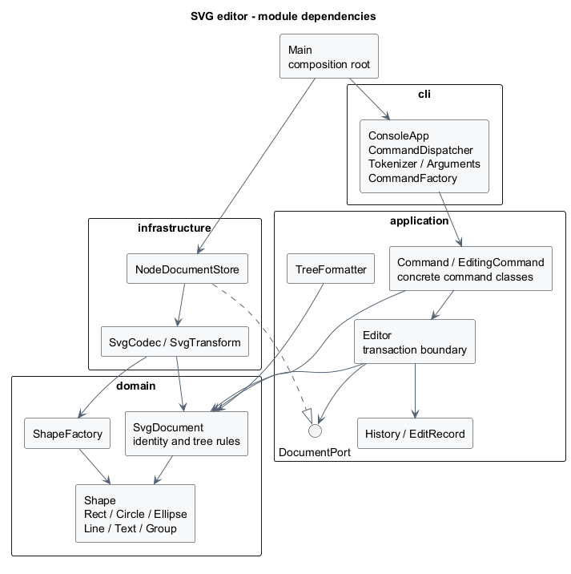

# PJ1 Phase 2：插件实践与插件式重构（未提交工作树的核对记录）

> 本文原有的“Phase 1”章节记录 `final` 版本，不能当作 Phase 2 已验收的声明。以下 Phase 2 章节区分已存在的源码、已运行的本地测试和仍缺少的证据。`final` 是已核对的 Phase 1 Git tag；本地 `p2` 尚不存在，原有 tag 不移动。作业附件 `phase_cli_2.md` A.1—A.3、§1—7 是需求来源。

## PJ1 Phase 2：插件实践与插件式重构（进行中）

### 可追溯状态与安装/复现

2026-11-23 文档复核时：本工作副本 `HEAD=final=cc58143fde0867fe6a8587c0d707ed35ac015ce2`，本地尚无 `p2` tag。`origin` **当前配置**为 `https://github.com/qingyvz/software-design-svg-editor.git`，但尚未通过远端查询证明它确为 Phase 1 的同一线上仓库，也未核实 push 权限与远端分支。首次草稿所记的“origin 为本地 bundle”已过时。Phase 2 的 CLI、VS Code 扩展源码和此文档仍在未提交工作树；本地测试通过不代表已提交、已推送或已取得真实 UI 截图。Phase 1 的 `--box` 是旧实现，不能充当本阶段“新增 box 不改内核”的提交 diff 实证。文末的 Phase 1 原有记录应按 `final` 的历史叙述阅读，不能当作 Phase 2 验收报告。

环境沿用根 `package.json`：Node.js ≥22；在工程根目录 `npm ci`、`npm run check`、`npm run cli -- --script <file>`。当前 `src/Main.ts` 接受 `--box`（仅 box 插件）、`--plugins`（按 `StatsPlugin → DirPlugin → BoxPlugin → StarPlugin` 代码装配）及 `--config plugins.config.json`（配置装配）。`npm run cli` 的脚本先执行构建，配置引用构建后的 JS 文件。扩展的安装、构建、F5 启动和示例步骤见 [vscode-extension/README.md](../vscode-extension/README.md)；扩展名由其 `package.json` 标识为 `svg-explorer-outline`。CLI 当前工作树 `npm run check` 的运行记录为 72/72 测试通过；本次再执行 `node scripts/check-architecture.mjs` 通过，输出 263 条相对导入。扩展包 `npm test` 的运行记录为 7/7；`.vscode-test/host-result.json` 记录宿主 API 测试 `passed`（参见下节）。这些结果只对应当时本地工作树，不能替代最终提交的复测；文末 Phase 1 的“50 项通过”仍是历史结果。

### 扩展点清单（`final` 基线与 2026-11-23 工作树静态核对）

下列路径都相对于仓库根目录。**内核接口及其调用点**列的是当前未提交工作树的代码，不把 `final` 误称为已包含 Phase 2 四个接口；运行证据由现有 72 项 CLI 测试（尤其 `test/plugin-behavior.test.ts`、`test/plugin-loader.test.ts`）和后面的会话对照提供，不能推及未覆盖的场景。

| 扩展点／接口及职责 | 当前调用边界（文件／函数）和实现／注册 | 不装可选插件 | 违约处理及待验证 |
|---|---|---|---|
| `ShapeProvider`：`src/domain/ShapeProvider.ts` 的 `create`、`fromSvg`，负责创建与 SVG 恢复一种图形 | `src/domain/ShapeFactory.ts` 的 `register/create/fromSvg/validate`；`src/application/EditContext.ts` 的 `create` 经工厂创建并调用 `SvgDocument.add`；`src/infrastructure/SvgCodec.ts` 的 `importElement` 经工厂恢复。`ShapeFactory.constructor` 登记六种 `BuiltinShapeProvider`；`src/plugins/BoxPlugin.ts` 经 `PluginInstaller.install` 登记 `BoxProvider`，`Main.ts` 的 `--box`/`--plugins` 或配置可选择它。 | 六种内置类型仍由工厂提供；`create box` 由工厂报未知类型；`g data-kind="box"` 在无专用 provider 时经通用 `g` 恢复。 | `ShapeFactory.register` 拒绝同 type 或 SVG key，`validate` 拒绝 id/tag 不符；`SvgDocument.add` 检查新增子树 id。`test/plugin-behavior.test.ts` 覆盖必要子部件、重复 id、坏结构读回及失败保留历史；其他组合不由此保证。 |
| `Command`：`src/application/Command.ts` 的 `execute`；插件以 `src/application/CommandContribution.ts` 的 `name/help/create` 自报名字、语法检查与命令构造 | `src/cli/CommandDispatcher.ts:run` 调 `src/cli/CommandFactory.ts:create` 后 `execute`；`CommandFactory.create` 先查内置表、再查 `CommandRegistry.all()`；`HelpCommand.execute` 附加贡献的 help 文案。内置命令仍在 `CommandFactory.constructor` 登记；`StatsPlugin.activate` 和 `DirPlugin.activate` 注册 `StatsCommand`/`DirCommand`。 | 内置命令可用；无贡献时 `stats`/`dir` 由 factory 报 `unknown command`，dispatcher 加 `error:`；`help` 不添加这两条。 | `CommandRegistry.register` 拒绝重名，`PluginInstaller.exists` 也核对内置命令名；插件无参规则由各自 `create` 检查；执行错误经 dispatcher 变为单行 `error:`。`test/plugin-loader.test.ts` 覆盖重名、清单不符、激活失败和继续加载。 |
| `TreeDecorator`：`src/application/TreeDecorator.ts` 的 `label`/可选 `checkpoint`，为 tree 行返回尾缀 | `src/application/Editor.ts:tree` 用 `TreeDecorators.all()` 构建 `TreeFormatter`；`src/application/TreeFormatter.ts:tree/suffix/children` 调每个 `label`；`Editor.init/read/save` 在成功后触发 `TreeDecorators.checkpoint`。`BoxPlugin.activate` 注册 `BoxTypeLabel`，`StarPlugin.activate` 注册 `ModifiedStar`。 | 装饰器数组为空时 `suffix` 返回空串；`cli-1` 的 `final` 对默认模式输出逐字节相等（仅限该会话）。 | `TreeDecorators.register` 拒绝重名。标签依序拼接；`ModifiedStar` 用实例内保存的基线比较内容。`test/plugin-behavior.test.ts` 覆盖 checkpoint、undo/redo、祖先与双标签；任意第三方 `label` 抛错时的隔离不由这些测试证明（见 [ADR 003](adr/003-dirty-tree-label.md)）。 |
| `AttributeHandler`：`src/application/AttributeHandler.ts` 的 `name/handles/apply`，定义图形＋属性的领域语义 | `src/application/commands/SetCommand.ts:apply` → `src/application/EditContext.ts:set` → `src/application/AttributeHandlers.ts:set`；`src/application/Editor.ts:executeEdit` 在草稿事务中调用。`BoxPlugin.activate` 注册 `BoxAttributes`，处理 box 的 fill/label。 | 无命中时调用原 `Shape.set`/各图形白名单；普通矩形的 fill 可修改，普通图形的未知 label 报错。 | `AttributeHandlers.register` 拒绝同名；`set` 在任何 `apply` 前拒绝多个命中，单命中失败**不**回退默认；`Editor.executeEdit` 的草稿仅在成功校验后提交历史。`test/plugin-behavior.test.ts` 覆盖多命中、局部修改后抛错及 redo 保留（见 [ADR 001](adr/001-attribute-contract.md)）。 |

`src/application/Plugin.ts` 定义四类贡献名与 `PluginContext`；`src/cli/PluginInstaller.ts:install` 暂存、比对 manifest、预查重名/SVG key、正式注册，并在提交异常时逆序 `remove`。`src/cli/PluginLoader.ts:load` 负责配置解析、模块解析和实例化，不是内核。`test/plugin-loader.test.ts` 包含缺模块、无默认导出、清单不符、激活失败、重名、提交阶段异常回滚及后续继续加载等定向用例；72 项套件通过，但不等于覆盖所有第三方插件或远端装配。`final` 只有 `ShapeProvider` 与命令抽象/内置表；它的 `Box.set` 内嵌属性逻辑不是独立的 `AttributeHandler`。Phase 2 当前 `Box.set` 仍保留 Phase 1 兼容分支，新的 handler 优先处理同一语义；已对 box 的 fill/label 和失败原子性添加测试。核对顺序为“接口 → 注册 → 调用 → 默认 → 错误/回滚 → 独立测试”，仅有接口文件不证明 OCP。

### 依赖关系、设计模式和取舍

实际 Phase 1 模块图见 [architecture-before.puml](architecture-before.puml)（原图 [architecture.puml](architecture.puml) 仍是 Phase 1 记录）。[architecture-after.puml](architecture-after.puml) 画**当前 CLI 工作树与已存在的独立 VS Code 扩展**，不是已提交版本图，也不是扩展运行截图。内核拥有领域模型及四个接口并调用接口；插件依赖公开领域类型及扩展点而不依赖 `Main` 或 loader；宿主决定装配和失败隔离。当前工作树 `ShapeFactory`、`CommandFactory` 构造器**仍列内置实现**，所以“所有内置实现都已经拆出内核”不能成立；题目允许内置实现通过注册机制装配，但须核对新增插件是否免改这两处。新增插件 OCP 的 A/B **独立提交**尚未出现，不能从工作树推断 `git diff C^ C`。本次 `node scripts/check-architecture.mjs` 输出 263 条相对导入通过，只检查依赖方向／类名／switch，不是架构全部性质的证明。

**Command**：`CommandDispatcher.run` 分词并按名查找命令，`EditingCommand` 通过 `Editor.executeEdit` 维护单条命令的撤销事务；`StatsCommand.execute` 和 `DirCommand.execute` 不调用 `executeEdit` 或 `history.barrier`。**Composite**：`ShapeContainer` 与 `Shape.walk` 使普通组和复合 box 共用创建、嵌套、遍历、移动等操作；`Box.assertCanDetach` 限制必需部件从容器移出。**Adapter** 的实际角色：`src/plugins/DirCommand.ts:execute` 是 Client；`src/plugins/DirectoryAccess.ts` 的 `cwd/list` 是 Target；`src/plugins/NodeDirectoryAccess.ts:cwd/list` 是 Adapter，将 `process.cwd()`、`node:fs.readdirSync`/`Dirent`（Adaptee）映射为 `DirectoryEntry`。`DirPlugin` 可注入实现同一接口的测试替身；adapter 将符号链接和其他非普通项标记为 `other`，命令输出 `[OTHER]  <name>`，不遍历链接目标。`dir` 顺序为目录、文件、其他，组内使用字符串比较排序；异常由 `DirCommand` 转成 `error: cannot read directory: <path>`。`test/plugin-behavior.test.ts` 已覆盖替身、真实目录、错误、未初始化及 redo 保留；Windows 环境不允许创建符号链接时该小分支会跳过，不承诺每次都验证了链接。**树行装饰**：`TreeFormatter.suffix` 将各 `TreeDecorator.label` 的字符串按注册顺序相连，它是可组合的尾缀流水线，不持有被包装的 TreeFormatter，也不实现相同渲染器接口，故不能误称为经典 Decorator 对象链。

### 插件装配和清单（当前本地源码与定向测试）

- 方式 A：`Main.ts` 的 `--plugins` 依次实例化 Stats、Dir、Box、Star，`--box` 只选择 Box；方式 B：根 `plugins.config.json` 的 `plugins` 数组列出构建后的 `./build/src/plugins/config/{stats,dir,box,star}.js`，每个配置模块 `default` 导出插件类。`--plugins` 与 `--config` 不应同时用于 A/B 逐字节对照，以免重复注册。`PluginLoader.load` 对 `enabled:false` 直接跳过；相对模块相对于**配置文件目录**解析，包名经 Node 的 `createRequire(...).resolve` 解析；`options` 原样传给 `PluginInstaller.install`/`activate`（示例插件当前没有消费它）。两种装配都调用 `PluginInstaller.install`；`test/plugin-behavior.test.ts` 的固定会话对照和仓库外三会话字节对照均通过，但仍需在最终提交复跑。
- §6 允许包的 `package.json` 用 `contributes` 声明 `shapes`、`commands`、`decorators`、`attributes` 四类注册名数组，缺省空。当前示例不是四个独立的 npm 包：由相对模块 `default` 导出类，清单写在插件实例的 `contributes`；`PluginLoader.packageManifest` 优先取最近 package.json 的 `contributes`，没有才使用模块或实例清单。`PluginInstaller.install` 暂存并比对名称集合、预查冲突，提交异常逆序回滚；详见 [ADR 004](adr/004-plugin-manifest-transaction.md)。加载器源码不硬编码具体插件包名，`Main.ts` 的代码模式则明确列出四类，符合组合根负责选插件的角色；已有提交阶段 checkpoint 异常回滚用例，但对任意插件的完整回滚仍不能泛化。
- 目标错误格式：`error: plugin not found: <module>`、`error: plugin has no default export: <module>`、`error: plugin manifest mismatch: <name> (declared: …, registered: …)`、`error: plugin failed to activate: <name> (<reason>)`、`error: duplicate registration: <category>/<name>`、`error: invalid plugin config`。`test/plugin-loader.test.ts` 已对模块自身缺失与依赖求值失败的分类、清单不符、提交阶段异常回滚、后续继续加载及非法配置逐项断言；无合法配置时 `PluginLoader.load` 返回错误列表，`Main` 仍启动默认内置能力。错误 reason 可能仍含本机绝对路径，不能宣称已经脱敏。

### VS Code A.1—A.3：实现、职责、模式与复用评估（截图未完成）

**实际状态。** 当前存在独立的 `vscode-extension/`：`package.json` 的扩展名为 `svg-explorer-outline`、入口为 `out/src/extension.js`；`src/extension.ts` 注册两个 VS Code provider，`src/svgSymbols.ts` 实现 SVG DOM 校验、层级遍历及 UTF-16 源码偏移扫描；`examples/example.svg` 与 `examples/ordinary.txt` 是演示文件。其 [README](../vscode-extension/README.md) 给出 `npm ci`、`npm test`、构建及由使用者在 VS Code 打开该目录按 F5 进入开发宿主的步骤。已记录 `npm test` 7/7；`.vscode-test/host-result.json` 的状态为 `passed`，宿主测试 `test/host.js` 覆盖装饰 API、原生符号命令、未保存编辑和损坏 XML。这是 API 级实测，**没有本人 Explorer/Outline 视觉截图，更不能因测试启动过宿主就声称交互画面已被检查**。题目 ZIP 的 `vscode-svg-badge.jpg`、`vscode-svg-outline.jpg` 仅是题目示意图。

**职责与注册/调用。** VS Code 拥有 Explorer 与原生 Outline 视图、文本缓冲区、文件 URI、文档变更事件、扩展激活和销毁生命周期。`src/extension.ts:activate` 注册 `SvgFileDecorations`（异步 `workspace.fs.stat` 确认真文件，仅 `.svg` 返回 badge `[]`）与 `SvgOutline`（按当前 `TextDocument.getText()` 返回带 `range`、`selectionRange` 的嵌套 `DocumentSymbol`）。`src/svgSymbols.ts:parseSvgSymbols` 用 `@xmldom/xmldom` 校验 XML，再由轻量扫描取得开、闭标签准确偏移；不完整输入返回空数组而非抛入宿主。VS Code 请求、渲染原生视图并处理点击，扩展不重建 Outline、不重命名或改写文件。Node 用例覆盖嵌套组、无 id 节点、偏移和编辑更新；宿主用例覆盖未保存编辑、无效 XML 和符号选择范围。**真实 UI 里点击节点定位及视觉效果仍须用持续打开的开发宿主手工核验和截图**，不能以 `host-result.json` 替代。

**模式辨析。** 文件装饰具有“给现有 Explorer 项追加展示信息”的 Decorator *效果*，但 provider 是由 VSCode 调用的对象，**没有**持有被包装的 Explorer 项/组件，也未实现与 Explorer 相同的组件接口并委托同名调用，故不是经典 Decorator 对象组合链。它把文件 URI/类型转换为 `FileDecoration`，DocumentSymbolProvider 把文本/XML 层级转换成 VSCode 的符号/范围；两者有 Adapter 的接口转换意味，但其 Host API 定义“目标”且扩展提供实现，和 `dir` 的显式 `DirectoryAccess` Target—`NodeDirectoryAccess` Adapter—Node FS Adaptee 结构不相同。不能仅凭一个类名把全部行为视作模式实现。

**Phase 1 复用判断。** `src/infrastructure/SvgCodec.ts:decode/importElement` 使用 `@xmldom/xmldom` 严格解析，`ShapeFactory` 只认识受支持的 SVG 图形；`SvgDocument`/`Shape.walk` 提供编辑语义与遍历，但原节点没有源文档 `Range`，会给无 id 元素分配 id。因此直接把 CLI 模型当 Outline 数据源会丢源码定位、遗漏其他 SVG 标签，并在残缺 XML 上报错。实际扩展**复用了 XML 解析库和校验思路，不导入 `SvgCodec` 或 CLI 图形模型**；独立的源码扫描提供偏移，DOM 遍历转换为符号。不应把“共享依赖”描述为直接代码复用。当前解析策略对不完整文档返回空 Outline，并非部分容错恢复；已由测试覆盖，后续实机仍须检查视觉与操作体验。

### 回归会话、度量及 Git 实证（区分已通过与未完成）

`doc/transcript/cli-1.txt` 是 Phase 1 §6 的**命令输入**；所需 SVG 的仓库原件为 `examples/other.svg`。`cli-box.txt` 对应 §6.1 版本 B，`cli-plugins.txt` 用于新命令；不能把 `svg>` 提示符或示例输出当作 CLI 输入。已存在仓库外作业目录 `draft/verify-transcripts.mjs` 与 `draft/transcript-evidence/result.json`：脚本分别为每次运行建立同结构临时目录，复制 Phase 1 `examples/other.svg`，运行已构建的 `final` 与当前工作树 CLI，将 stdout/stderr 写到工作目录外；`result.json` 中 `failed:false`，所有运行退出码 0，四组比较为 `byteEqual:true`：`cli-1` 的 `final` vs `default`，以及 `cli-1`、`cli-box`、`cli-plugins` 各自的 `code` vs `config`。**这不是最终提交树或远端的证明**：验证脚本和输出位于仓库外 `draft/`，若需可复现的仓库内交付，后续须由负责集成的任务明确纳入或提供可访问路径；早期 `draft/phase1-base-output.txt` 不因本次比较而自动成为可信金标准。`dir` 输入目录包含固定的 `docs/`、`plugins/`、`.hidden`、`package.json` 和 `other.svg`，输出在目录外；两运行生成的是同结构目录而非同一路径，当前用例的 `dir` 不输出 cwd 绝对路径。

指标由 [docs/metrics/generate.mjs](../docs/metrics/generate.mjs) 在 Git 中读取 `final` 与目标**已提交树**，不使用未提交文件，不包括测试/构建/依赖。`src/domain`/`src/application` 归内核，`src/cli`/`src/infrastructure`/`src/Main.ts` 归宿主装配与适配器，`src/plugins` 归插件；VS Code 单列。脚本的圈复杂度是语法代理指标，其定义、文件顶层声明与逐文件对照在 [report.md](../docs/metrics/report.md)。当前 `HEAD=final`、`p2` 尚未创建，report 仅是**已提交树的中间零增量**；其中 VS Code 为 0 不表示当前工作树没有扩展。最终提交后才对已提交树重新生成真实增量；若报告须纳入 tag，先提交代码与脚本、以固定目标提交生成并提交报告，再创建 tag，并核对报告目标和最终提交对应。脚本已将 `vscode-extension/` 的生产 TS 单列，不计入 CLI；如果最终代码位于未识别目录，先更新分类规则，不能手填数字。本子任务不建提交或 tag。

分别对接入新插件的 A/B **独立提交**运行 `git diff --name-status C^ C`，列明新增目录、唯一组合根/配置变更及必要的测试与依赖元数据。确认真实路径存在并排除本次新插件目录后，再查内核和既有插件 diff；空 diff 单独不能证明路径存在。只有可访问同一远程分支与 `p2` tag 时才能声称远程交付完成。

### AI 协作检查记录（只记录观察与实际修正）

1. 根据题目审查 `final` 代码，发现 Phase 1 已有 `ShapeProvider`、`--box`，但 `Box.set` 的内嵌属性逻辑不能替代独立 `AttributeHandler`；故将“已有 box”与“Phase 2 完成插件接入”分列，提出 ADR 001 的显式冲突/事务约定。随后工作树出现独立接口及 handler，`Box.set` 的兼容分支仍在；`test/plugin-behavior.test.ts` 已覆盖 box 属性传播、局部失败和撤销/重做，仍不等于对所有属性输入穷尽检查。
2. 查看 `SvgDocument.delete/addTo` 与 `BoxProvider.fromSvg`：读回检查必要部件已有基础，但普通命令仍可能移除部件；据此提出 ADR 002 的结构保护和失败原子性验证。后续源码加入 `assertCanDetach`，定向测试覆盖必需部件移除失败及坏 box 读回失败，不把历史评测报告当作本轮实际通过证据。
3. 起初指标报告对 `HEAD` 与 `final` 的值完全相同，核实两者确实是同一提交 `cc58143`。因此脚本明确写出 warning，不把“0 增量”报告冒充 Phase 2 的改进结果；等最终提交/标签生成后再计算。再次核对 `git remote -v` 时发现 `origin` 已从最初记录的本地 bundle 改为 GitHub URL；只更正文档配置事实，**没有**从该 URL 推断远端历史或权限。
4. 再次核查发现本文把扩展写成“没有源码”，但当前目录已有 `vscode-extension/src/extension.ts`、`svgSymbols.ts`、示例及测试。已更正状态和架构图，区分 7/7 Node 测试、宿主 API `passed` 与仍缺的本人真实截图。用户指出反复打开又关掉 VS Code；自动宿主测试确实会短暂启动并结束，不应伪装成可见窗口验收。本次文档修正**没有启动 VS Code**，后续真实截图需要由持续打开的可见开发宿主单独完成。

**收尾核对清单：** 当前四接口、插件与异常路径有本地代码和定向测试；Phase 1/三会话字节对照有仓库外报告；扩展 Node 与宿主 API 有结果。仍需**本人 VS Code Explorer/Outline 真实运行截图及点击体验确认**、把需交付的会话证据纳入仓库、核对所有 ADR 与最终代码、在提交树上重新生成非零指标、分阶段提交的 OCP diff、远端同仓库身份/推送状态及本地/远端 `p2`。未完成项不得靠报告总分或测试数字补齐。

### 并行源码的首次路径核对（历史静态快照，后续已补测试）

以下为写文档时再次读取到的**未提交源码位置**；表中的“待验证”反映首次静态检查的时间点。后续的定向测试与会话结果见前述章节，不应把工作树文件误写成 `final` 中已有代码，也不能把本表当作最终提交差异。

| 插槽或功能 | 当前工作树中的入口与调用点 | 当前可读实现／仍需核验 |
|---|---|---|
| `ShapeProvider` | `domain/ShapeProvider.ts`；`ShapeFactory.register/create/fromSvg`、`EditContext.create`、`SvgCodec.importElement` | `BuiltinShapeProvider`、`BoxProvider`；后续已有结构保护、读回与坏结构失败用例。 |
| `Command` 贡献 | `application/Command.ts`、`CommandContribution.ts`、`CommandRegistry.register`；`cli/CommandFactory.create`、`CommandDispatcher.run` | `StatsPlugin`/`DirPlugin` 和命令对象已出现；后续已有 help、参数、禁用后未知命令用例。 |
| `TreeDecorator` | `application/TreeDecorator.ts`、`TreeDecorators.register/all/checkpoint`；`TreeFormatter.tree/suffix/children`；`Editor.tree/init/read/save` | `ModifiedStar`、`BoxTypeLabel`；后续已有双标签、成功 IO checkpoint、undo/redo 用例。 |
| `AttributeHandler` | `application/AttributeHandler.ts`、`AttributeHandlers.set`；`EditContext.set`、`SetCommand.apply`；`Editor.executeEdit` | `BoxAttributes` 对 box fill/label；后续已有多命中、局部失败及历史原子性用例。 |
| 代码／配置装配 | `Main.ts` 的 `--plugins`/`--config`，`cli/PluginInstaller.install`，`cli/PluginLoader.load`，根 `plugins.config.json` | Installer 暂存四类后验证 manifest 再提交；示例配置引用编译后 `build/src/plugins/config/*.js`，须先构建。上文记录了后续加载器定向测试及三会话对照；不能据此声称任何第三方包都已验证。 |
| `dir` Adapter | `plugins/DirectoryAccess.ts` 的 `cwd/list`，`DirCommand.execute`，`NodeDirectoryAccess.cwd/list` | Node Dirent 的符号链接与其他特殊项标记 `OTHER`，不遍历目标；后续已用替身与真实临时目录运行测试（符号链接分支可能因 Windows 权限跳过）。 |

本轮对此新增一个 AI 协作复核：原先草稿写“其他三个接口尚未出现”，随后并行源码出现 `AttributeHandler`、`TreeDecorator` 等文件；没有把旧时间点的判断当最终事实。目录适配器的符号链接策略可从 `NodeDirectoryAccess.list` 读出为 `OTHER`，也从泛泛“待填”改成具体、可测的设计说明。**图中的 Phase 2 工作树结构仍待和最终提交作一致性检查。**

工作树当前的插件入口是：`StatsPlugin`/`StatsCommand`、`DirPlugin`/`DirCommand`、`BoxPlugin`/`BoxProvider`/`BoxAttributes`/`BoxTypeLabel`，及 `StarPlugin`/`ModifiedStar`。`DirectoryAccess` 的 Target 接口与 `NodeDirectoryAccess` 的 Adapter 也均在 `src/plugins` 包内，因而 `DirCommand` 只依赖同一插件包提供的目录端口；与下层 Node `Dirent` 的映射在 Adapter 中完成。该角色对应可从源码核对，且 `test/plugin-behavior.test.ts` 有替身与真实临时目录用例。

`Plugin`、`PluginContext` 和 `PluginManifest` 定义于 `src/application/Plugin.ts`；`BoxPlugin.activate` 为同一插件注册 box 图形、属性处理器及 `(box)` 标签，`DirPlugin.activate` 与 `StatsPlugin.activate` 分别注册 `dir`/`stats` 命令，并提供对应 `help` 文案。除源码静态结构外，`test/plugin-loader.test.ts` 已对缺失模块/默认导出、清单一致性、options 与配置路径规则作定向断言。

另一次静态核对：`SvgDocument.delete/group/addTo` 已调用可选 `ShapeContainer.assertCanDetach`，`Box.assertCanDetach` 对两个必要子 id 拒绝脱离；这比 Phase 1 基线多一层结构保护。初版 `PluginInstaller.install` 在四类暂存校验后逐一写正式表，遇到次级 SVG key 冲突可能局部提交。该反例经检查被提出，随后工作树出现 `ShapeFactory.hasSvg` 预检、逐类 `committed` 记录和 catch 中的反向 `remove` 回滚；`test/plugin-loader.test.ts` 已覆盖 SVG key 冲突和提交阶段异常回滚。它也说明只有“临时列表”还不构成完整原子注册；其他异常输入仍须持续检验。

初次复核发现 `PluginInstaller.names(pending)` 在 try 外读取贡献对象的 `.type/.name`；后续源码把贡献校验和取名移入 `try`，并增加抛错 getter 的定向测试，`test/plugin-loader.test.ts` 所在的 72 项套件运行通过；[ADR 004](adr/004-plugin-manifest-transaction.md) 的早期风险表述现为历史快照，不能继续称“未修复”。`ModifiedStar.signature` 的属性 Map 遍历顺序仍可能让仅属性排列变化被判为 dirty，现有测试没有针对这个输入，不能把设计期望写成结果。

## 以下为 `final` 的 Phase 1 原有文档（历史记录，非本轮 Phase 2 验收）

本节保留原始设计、过程与当时测试记录；其中 `src/plugins` “仅有 Box”、`--box` 方式、50 项测试及覆盖率均指 Phase 1。请以本文开头的 Phase 2 扩展点清单、当前代码和**新运行证据**判断 Phase 2，而不是把下文的旧结果当作本次通过。

## 架构方案

### 模块划分

| 目录 | 职责 | 主要类型 |
|---|---|---|
| `src/domain/` | 图形、变换、文档树和图形注册 | `Shape`、`ShapeContainer`、`Group`、`SvgDocument`、`AffineTransform`、`Bounds`、`TextMeasurer`、`ShapeFactory`、`ShapeProvider` |
| `src/application/` | 编辑事务、范围、历史和文档操作 | `Editor`、`EditContext`、`EditScope`、`History`、`EditRecord`、`ShapeFormatter`、`DocumentPort` |
| `src/application/commands/` | 保存请求参数并执行具体命令 | `MoveCommand`、`RotateCommand`、`CreateCommand` 等 |
| `src/cli/` | 分词、参数检查、命令构造和输出 | `Tokenizer`、`Arguments`、`CommandFactory`、`CommandDispatcher`、`ConsoleApp` |
| `src/infrastructure/` | SVG 语法转换和文件读写 | `SvgCodec`、`SvgTransform`、`CanvasTextMeasurer`、`NodeDocumentStore` |
| `src/plugins/` | 可选图形扩展 | `Box`、`BoxProvider` |
| `src/Main.ts` | 创建对象、注册插件并注入依赖 | 程序入口 |

`commands/` 是应用层的子目录。模块依赖见下图，图源为 [architecture.puml](architecture.puml)。

图形的坐标、样式和子节点由对象内部维护。属性表、子节点列表和 `Editor.inspect()` 返回副本；仿射矩阵不可变。

### 设计模式与职责

命令部分采用 **Command**，角色划分参考 `command.pdf` 第 11—12、16—17 页。`CommandFactory` 创建命令并绑定接收者 `Editor`，`CommandDispatcher` 通过统一接口执行命令。`EditingCommand.execute()` 固定编辑流程，具体命令只实现 `apply()`。

例如，`MoveCommand` 通过 `EditContext` 找到目标，然后调用 `move(dx, dy)`。命令不用判断目标是矩形还是分组，也不负责坐标计算。上下文统一处理目标范围、默认父容器和图形创建。

图形结构采用 **Composite**，对应 `composite.pdf` 第 10—14 页。五种叶子和 `Group` 都继承 `Shape`。容器内部保存 `Shape[]`，移动、缩放和矩阵变换递归调用子节点的同名方法。树操作通过 `shape.container` 获取 `ShapeContainer` 能力，不再要求容器必须继承 `Group`。解组限制由容器的 `assertCanUngroup()` 决定。

撤销和重做使用两个栈。`EditRecord` 封装一次编辑前后的快照，图形通过多态 `clone()` 复制自身：

1. 复制当前文档，为本次命令建立 `EditContext`。
2. 在副本上执行编辑，检查 id 唯一、无环和无共享子节点等约束。
3. 成功后替换当前文档，记录历史并清空 redo 栈；失败则丢弃副本。

删除子树、分组和批量旋转都只占一个 undo 单元。完整快照便于恢复原来的浮点数值和对象类型，代价是 K 次历史需要保存 O(KN) 个节点，深层树的复制还包含重复的子树校验。大图纸应改用差量记录。

图层模式使用 `EditScope` 策略。`CanvasScope` 允许编辑整幅图，`LayerScope` 只允许编辑当前容器的后代。所有编辑命令共用 `EditContext`，没有在每个命令中另写一套模式判断。切换图层属于会话状态，不进入文档历史。

### 变换与插件

`AffineTransform` 保存六参数仿射矩阵，负责组合、平移、缩放、绕点旋转和点坐标计算。叶子保存局部几何属性及矩阵，容器把操作递归交给子节点。旋转矩形、椭圆和文字使用同一条调用路径。

SVG 读入时将祖先变换合并到叶子。纯平移和正等比缩放继续归一化为坐标、尺寸，并换算字号和线宽；其他变换保留为矩阵。这样既保持原题 CLI 的坐标输出，又能无损表示旋转和非等比缩放。树节点之间移动不会重新解释祖先坐标系。矩阵顺序遵循 [SVG 坐标变换规则](https://www.w3.org/TR/SVG/coords.html)。

`ShapeFactory.register(provider)` 同时登记命令创建和 SVG 恢复规则。`Main` 将同一个工厂注入 `Editor` 与 `SvgCodec`，`CreateCommand` 不再创建自己的工厂。SVG 恢复按元素名及可选的 `data-kind` 查找提供者；未安装对应插件时，带标记的 `g` 仍读为普通分组。

可选的 `BoxProvider` 创建矩形与文字组成的 `Box`。`Box` 实现填充色和标题的传播、克隆以及禁止解组的规则，核心树操作和序列化中没有 box 分支。启用方式是 `--box`，默认仍只注册题目要求的六种类型。

### 展示与布局边界

`ShapeFormatter` 在应用层组织 show/tree 的摘要和父节点名称。领域对象只提供数据与行为，不再返回 CLI 文本；新入口可以使用自己的展示方式。

`Shape.bounds()` 返回画布坐标中的轴对齐几何边界，空容器返回 `undefined`。矩形和线段使用变换后的顶点；圆和椭圆使用仿射椭圆的极值；容器合并子节点边界。插件继承这些能力，布局命令无需按图形类型分支。`SvgDocument.bounds()` 先解析祖先样式，`EditContext.bounds()` 还会检查当前编辑范围。

文字通过领域接口 `TextMeasurer` 获取排版宽度和墨迹边界。基础设施层的 `CanvasTextMeasurer` 适配 Canvas 的实际测量值，使用字母基线，按 text-anchor 调整位置，并恢复调用方的 Canvas 状态。度量定义参见 [HTML Canvas 文本规范](https://html.spec.whatwg.org/multipage/canvas.html#textmetrics)。布局调用方需要提供已加载所需字体的测量器；未提供时明确报错，不按字符数猜测宽度。

`bounds.test.ts` 中的左对齐命令只调用选择、边界和移动接口，验证旋转图形、椭圆、box 及重叠选择可共用同一编辑事务。该命令是扩展探针，未加入默认 CLI。

### 依赖方向

- `domain` 只依赖本层，不引用 CLI、XML 库和文件系统。
- `application` 依赖 `domain`，通过自己定义的 `DocumentPort` 完成读写。
- `cli` 依赖 `application`，并复用 `domain/Numbers` 解析数值。
- `infrastructure` 依赖应用层端口和领域模型，适配 Node 文件 API 与 XML 库。
- `plugins` 只依赖领域接口和自身实现。
- `Main` 负责装配与注册。

命令名和图形类型名分别在 `CommandFactory`、`ShapeFactory` 中分派，两处都提供外部注册接口。内置定义目前仍在构造器中登记，后续可把这部分移到独立装配模块；这是保留的待重构点。

### 变化点检查

| 变化 | 现有支持及验证 |
|---|---|
| 图层编辑模式 | `LayerScope` 统一限制创建、移动、删除、分组等操作；不修改各命令的几何逻辑 |
| 多选批量旋转 | `RotateCommand` 调用矩阵接口；选择同时包含祖先与后代时，只处理祖先一次 |
| 新增复合图形插件 | 增加 `ShapeProvider` 和图形类，在装配处注册；box 已验证创建、克隆、限制和读回 |
| 批量平移 | `MoveManyCommand` 使用同一批量选择接口和编辑事务 |
| 新增命令或入口 | 命令可通过 `register()` 注入；GUI 可直接构造应用层命令 |
| 自动布局 | 统一 bounds 与可注入文字测量；左对齐探针验证混合图形、插件、单次撤销和失败回滚 |
| 更换存储或 XML 库 | 替换 `DocumentPort` 或 `SvgCodec` |
| 大图纸与完整 SVG | 仍需处理历史存储成本、路径、CSS 等未实现内容 |

## 过程记录

我使用 Codex 辅助实现代码和测试，主要迭代如下。

### 命令与历史

最初对照 Command 和 Composite 课件划分职责：命令保存参数，文档维护树结构，图形负责几何计算。命令层先写了撤销、分支重做、IO 后的历史限制和失败回滚测试。首次运行时相关类还未实现，编译未通过；补齐后，早期测试共 11 项通过。这部分参考 `tdd.pdf` 第 4—12 页的测试先行方法。

组内第二个图形缩放时溢出的用例，促使编辑过程采用副本。它要求第一个图形已经计算成功时，整条命令失败仍能保留原文档和历史。成功 save、失败读写、只查询尺寸的 canvas 也分别处理。

### SVG 与快照

自动补 id 改成先收集显式 id，再分配缺失值，避免抢占后面节点的名称。XML 类型检查发现 `localName` 可空后，加了 `tagName` 回退。

标准会话测试曾出现 `detached shape: box`。原因是测试混用了两个 `inspect()` 副本中的对象和父节点，随后改为在同一快照中查询，保留了对象归属检查。

### 透明度修正

复查时发现，父组和子图形各有 0.5 透明度，解组后子图形却仍为 0.5。最初把 opacity 和 fill 一起当作继承属性处理，这是错误的。

我先加入四个回归用例，确认原实现全部失败。修正后，单个子元素的透明度与父组相乘，fill-opacity 等继承属性仍由子元素的显式值覆盖。数值和百分数会规范化，非法输入报错。

组透明度作用于子元素合成后的图像，不能简单分配给多个子元素，参见 [SVG 组透明度定义](https://www.w3.org/TR/SVG11/masking.html#ObjectAndGroupOpacityProperties)。因此，含多个直接子元素且透明度在 0 与 1 之间的组会拒绝解组，原文档与历史保持不变。单个子元素即使本身是含重叠图形的组，仍可整体合并透明度。

### 扩展接口调整

原模型只保存位置和尺寸，旋转需要逐类改动；原工厂又在创建命令里直接实例化。我把仿射矩阵放入领域层，将工厂注入到编辑器和编解码器，再用实际的批量旋转、图层模式和 box 插件检验接口。

图层测试覆盖了各个编辑命令的越界目标、默认创建位置、失败回滚及 undo 后图层消失的情况。插件测试还使用了一个不继承 `Group` 的容器，检查树操作是否真的依赖能力接口。

### 继承与职责复查

后续评审给出的嵌套 fill=inherit 用例复现了另一处解组缺陷。移除父组时，子节点显式 inherit 也必须固定到该父组的属性值。补充的测试覆盖颜色、字体属性、父级继续继承以及撤销重做。

同时将图形摘要移到 `ShapeFormatter`，增加统一边界与文字测量接口，并给最低共同祖先、分组插入位置、缩放矩阵和重叠选择补充说明。边界测试使用固定度量验证坐标计算，Canvas 适配器测试验证度量字段与状态恢复；它们不代替真实字体加载验证。

### 提交记录

| 提交 | 内容 |
|---|---|
| `ae1045e` | 工程结构与架构检查 |
| `cb2de0c` | 图形、分组和领域测试 |
| `15e7777` | 命令执行与撤销重做 |
| `d3630ed` | SVG 读写、CLI 和集成测试 |
| `79b968c` | 设计文档和架构图 |
| `1dcb3b9`、`385e981` | 文档整理和仓库入口 |
| `987f101` | 修复解组透明度并通过容器能力访问结构 |
| `5f3aef8` | 统一仿射变换及 SVG 变换读写 |
| `6062233` | 开放图形提供器注册并注入创建与导入流程 |
| `c202ba6` | 集中编辑范围校验并支持图层模式及命令注册 |
| `94ebeb2` | 增加批量旋转和平移并合并重叠选择 |
| `f389fb6` | 加入可选 box 插件并验证扩展协作 |
| `90393e8` | 修复解组时显式 inherit 的样式解析 |
| `13b10cf` | 将图形展示格式移出领域模型 |
| `c6f15b4` | 提供统一几何边界和可注入文字测量以支持布局 |
| `332f5bb` | 统一代码排版并说明组合与变换算法 |

上述扩展最初集中在一个本地提交中，复查后在发布前按职责拆分，并逐段运行检查。本文提交编号已与当前仓库同步。最终版本由 `final` 标签定位。

## 一致性自查

四个原有模块保留，新增 `plugins/` 作为可选扩展。应用层增加 `EditContext` 和范围策略；领域层增加仿射矩阵、容器能力和提供者接口。模块表及组件图已同步。

依赖检查通过，共检查 194 条相对导入。抽查结果：

| 文件 | 依赖情况 |
|---|---|
| `domain/Group.ts` | 只依赖领域类型，递归操作不引用命令或 IO |
| `domain/SvgDocument.ts` | 通过容器能力操作结构，无 `instanceof Group` 限制 |
| `application/commands/CreateCommand.ts` | 依赖编辑上下文，不自行构造工厂 |
| `application/commands/RotateCommand.ts` | 依赖统一矩阵和选择接口，无图形类型分支 |
| `infrastructure/SvgCodec.ts` | 从注入的工厂恢复图形，无 box 专用判断 |
| `plugins/BoxProvider.ts` | 只依赖领域模型和 Box |
| `cli/CommandDispatcher.ts` | 执行注册后的命令，不操作树节点 |

`scripts/check-architecture.mjs` 检查跨层导入、一类一文件和额外的 switch 分派。代码采用统一格式，将压缩在一行的多步操作和注册项展开。

## 质量保证手段

### 功能检查

| 功能 | 测试位置 |
|---|---|
| 六种图形、浮点及负坐标、id、树操作和顺序 | `domain.test.ts`、`requirements.test.ts` |
| 编辑命令、撤销重做、失败回滚与 IO 后的历史限制 | `editor.test.ts` |
| XML 转义、中文、自动补 id、文件读写和 CLI | `svg.test.ts` |
| 解组透明度、重叠合成保护、透明度输入 | `opacity.test.ts` |
| 解组显式继承、字体属性与撤销重做 | `inheritance.test.ts` |
| 几何边界、文字度量与布局扩展 | `bounds.test.ts` |
| 矩阵、批量编辑、图层范围、插件及命令注册 | `extensions.test.ts` |

测试用 `MemoryDocumentStore` 模拟读写失败，用临时目录验证真实文件行为；这部分参考 `tdd.pdf` 第 14—17 页的依赖注入和测试替身。

### 验证结果

- 50 项测试全部通过，架构检查通过。
- 源码行覆盖率 99.54%，分支覆盖率 92.27%，函数覆盖率 99.47%。统计对象为编译后的应用 JavaScript，不包含测试文件。
- 独立使用 resvg 对比六组图像：显式继承解组、单图形解组、子组解组、拒绝有损解组、复杂仿射变换读写、批量旋转。共比较 659200 个 RGBA 通道，差异为 0。
- GitHub Actions 在 Windows 和 Ubuntu 的 Node 22 环境执行 `npm run check`。
- 原题示例与可选插件示例均保留在 `examples/`，运行方法见根目录 [README](../README.md)。

### 实现约定与限制

1. `front` 放到同级序列末尾，`back` 放到开头，遵循 SVG 绘制顺序。
2. `group` 按文档的深度优先顺序收编节点；跨父级时放在最低共同祖先中，位置取最早被选节点所在分支之前。
3. 顶层容器、box 以及无法保持透明度合成的分组不能解组。合法解组后，子节点占据原组位置。
4. CLI 的 `scale` 缩放几何位置和尺寸，不缩放样式线宽及文字字号。旋转后的图形继续按画布坐标移动和缩放；show/tree 同时显示局部几何和矩阵。
5. 批量选择包含祖先和后代时只处理祖先；重复 id 或无效目标报错，整条命令不生效。
6. 图层模式限制编辑目标和创建位置。显示、文件读写及文档历史仍作用于整个文档；切换图层不清空历史，undo/redo 后若当前图层不存在则回到画布。
7. 默认六种图形；box 需显式启用。不支持路径、CSS 样式表、tspan、滤镜和 GUI，也不把仿射变换支持等同于完整 SVG 支持。
8. 输入上限为 20 MiB、20000 个元素、256 层嵌套。保存先写同目录临时文件，再重命名替换目标文件。

9. 边界不包含描边、滤镜和裁剪；旋转文字返回测量所得墨迹矩形的变换包围盒。Canvas 适配器支持数值或 px 字号、字体族和字重，不实现完整 CSS 排版。
