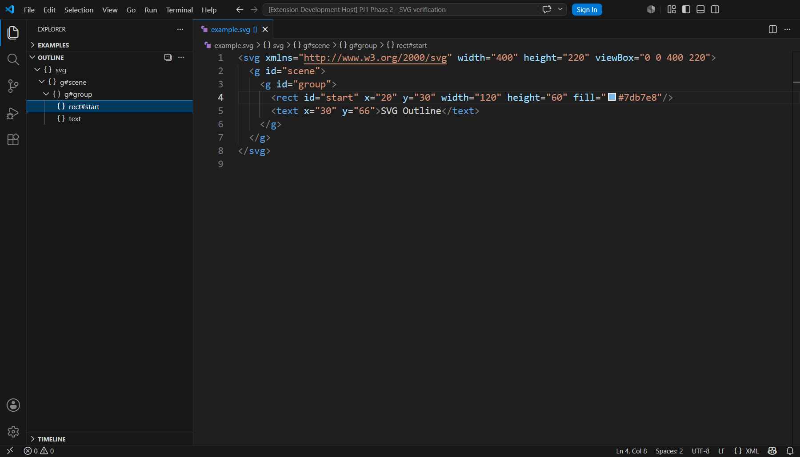
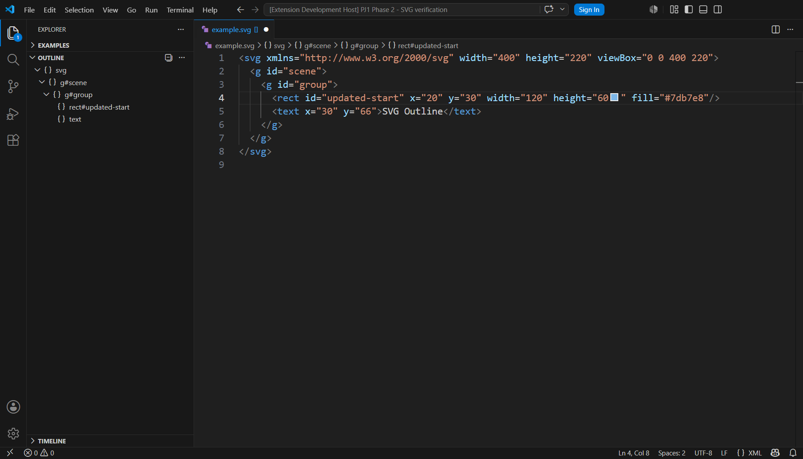
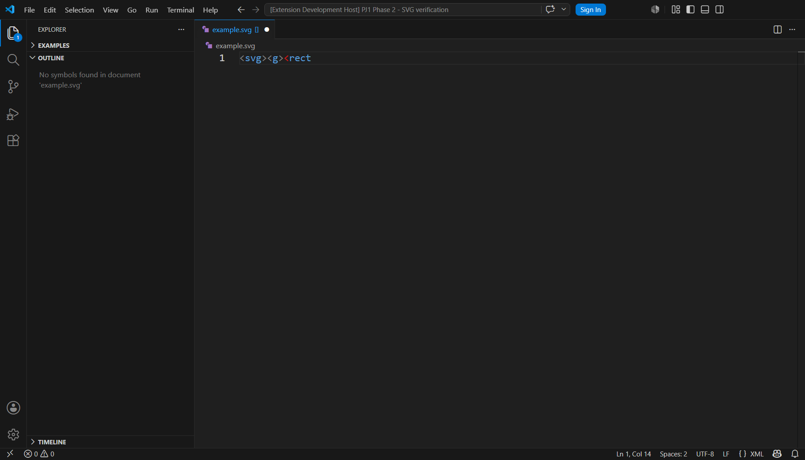

# PJ1 Phase 2：插件实践与插件式重构

本阶段完成 VSCode 文件标记／大纲，以及 CLI 四类扩展点、stats、dir、box、两个树标签和双装配。Phase 1 的 `final` 标签保留。开发过程、未提交实现的接收快照及后续修正见 [iteration-log.md](iteration-log.md)；最终版本以 `p2` 与独立审查结果核验，正式提交另行审批。

## 安装、运行与复现

工程根目录要求 Node 22+、npm、Git；扩展另需桌面 VSCode 1.96+。执行 `node --version`、`npm --version`、`git --version` 检测，缺少则安装官方工具并重开终端。

```sh
npm ci
npm run check
npm run cli -- --plugins
npm run cli -- --config plugins.config.json
```

下载依赖失败时检查网络、代理和证书后重试 `npm ci`，保留锁文件；不依赖开发机额外全局 npm 包。干净构建只清理本仓库已检查的 `build/`。程序接口现在要求显式注入形状工厂／编解码器，默认产品组合在宿主；测试用 `test/Fixtures.ts` 装配，不能把测试辅助 API 当作运行内核依赖。独立扩展的 F5、Text Editor 与故障恢复步骤见 [扩展 README](../vscode-extension/README.md)。

## 扩展点清单

接口均在内核侧。内核不负责选择具体扩展实现；默认六图形由 `host/DefaultShapes.create` 登记。可选插件各有自己的 `package.json/contributes`、类实现和默认导出，源码位于 `src/plugins/{stats,dir,box,star}/`。

| 扩展点／职责 | 内核调用（文件／函数） | 实现、缺省与违约行为 |
|---|---|---|
| `domain/ShapeProvider`：创建与 SVG 恢复 | `domain/ShapeFactory.register/create/fromSvg/validate`；`EditContext.create`、`SvgCodec.importElement` 消费工厂 | 默认 `BuiltinShapeProvider` 适配六类型；可选 `box/BoxProvider`。无 box 时创建报未知类型、带标记的 g 以普通 g 恢复。重复 type 或 SVG key 拒绝；返回 id/tag 不符报错，命令失败不提交草稿。 |
| `application/Command`／`CommandContribution`：可执行请求、名称／语法／help | `cli/CommandFactory.create` 查注册表，`CommandDispatcher.run` 调 execute；`HelpCommand.execute` 合并贡献文案 | StatsPlugin／DirPlugin 各注册一个命令。无贡献时保留原命令表，相应命令报 `error: unknown command: stats/dir`。参数规则由插件检查，重名被 installer 拒绝。Command 的接收者为泛型，公开 `CommandReceiver` 不泄露 Editor 字段；StatsCommand 只要 DocumentQuery，DirCommand 不接收文档服务。 |
| `application/TreeDecorator`：每行有序后缀及保存点 | `Editor.tree` → `TreeFormatter.tree/suffix`；`Editor.init/read/save` → `TreeDecorators.checkpoint` | `star/ModifiedStar` 与 `box/BoxTypeLabel`。数组为空时后缀为空、原 tree 字节不变。按注册顺序拼接，重复名拒绝。label 抛错由 CLI 命令边界输出 error；运行期 checkpoint 抛错则 warning 并禁用该标签，继续其他回调，已成功 IO 保持成功。注册期异常仍回滚安装；label/handles 须遵守只读契约。 |
| `application/AttributeHandler`：图形＋属性的领域行为 | `SetCommand.apply` → `EditContext.set` → `AttributeHandlers.set`，始终在 `Editor.executeEdit` 草稿事务内 | `box/BoxAttributes` 处理 fill／label。零命中回原 Shape.set 白名单；多命中先报冲突；单命中执行失败不回落。一次 set 一个 EditRecord，部分失败丢弃草稿并保留 undo/redo。 |

注册事务见 `cli/PluginInstaller.install`：暂存四类贡献，检查贡献格式、类别／名称集合、重名和 SVG key，再登记；提交阶段失败逆序撤销本插件已登记项。只保留已经成功的其他插件。接口不允许插件通过封装外的可变引用偷偷修改实时文档。

## 架构与设计决策

[重构前 PlantUML](architecture-before.puml) 对照 `final`；[重构后 PlantUML](architecture-after.puml) 对照当前实现。

| 模块 | 职责与允许依赖 |
|---|---|
| domain | 图形／树／变换／不变量及 ShapeProvider、ShapeFactory；仅依赖领域对象和端口，不选插件。 |
| application | 文档会话、草稿事务、历史、范围、显示及扩展契约；依赖 domain，IO 通过 DocumentPort。 |
| cli／infrastructure | CLI 分词与调度、模块装载；SVG XML 与文件系统适配公开端口。 |
| host／Main | 默认提供器与服务组合；决定实例、插件集合、顺序、options 和代码／配置装配。 |
| plugins | 依赖公开领域能力、扩展点和自身实现；不引用 Main、加载器或 CLI 内部实现。 |
| vscode-extension | 单独的宿主适配包，独立依赖 VSCode API 与 XML 解析器；CLI 不依赖它。 |

**Command**：调用者只调 execute，编辑请求将参数交给接收者／EditContext，事务和历史统一管理。查询命令不进入编辑事务。**Composite**：ShapeContainer 表达子树能力，普通组和 box 递归组合、统一 move／delete 等操作；必要部件限制由容器契约负责。**Adapter**：DirCommand 是 Client，DirectoryAccess 是 Target，NodeDirectoryAccess 是 Adapter，process.cwd／node:fs／Dirent 是 Adaptee；测试注入同一 Target 的替身，命令不依赖 Node API。

树后缀是有序、互不感知的规则流水线；经典 Decorator 还要求同接口对象包装与委托，不能只凭 TreeDecorator 这个名称认定结构成立。变化机制按四个独立扩展轴划分，保持公开接口足以完成任务；没有为选做功能引入额外通用总线。物理行数、类数和模式数量不作为设计好坏的替代指标。

四条可追溯 ADR：

- [001 属性匹配、冲突和事务](adr/001-attribute-contract.md)
- [002 box 读回与组成不变量](adr/002-box-import-and-invariants.md)
- [003 dirty、祖先传播与标签顺序](adr/003-dirty-tree-label.md)
- [004 清单、双装配和原子注册](adr/004-plugin-manifest-transaction.md)

## 插件装配、配置与边界

代码装配由 Main 实例化插件，配置装配由 PluginLoader 解析模块；二者都调用 PluginInstaller.install。配置格式为：

```json
{
  "plugins": [
    { "module": "./build/src/plugins/stats/index.js" },
    { "module": "./build/src/plugins/dir/index.js", "options": {} },
    { "module": "./build/src/plugins/box/index.js" },
    { "module": "./build/src/plugins/star/index.js" },
    { "module": "an-installed-package", "enabled": false }
  ]
}
```

按数组顺序加载；enabled:false 完全跳过；相对模块路径基于配置文件目录，裸包名由同版本 Node 的原生 ESM 解析器按配置目录处理，覆盖 import-only／双 exports、module-sync／node-addons 及运行条件；宿主的 NodeModuleResolver 调用独立编译的 NodeResolveWorker，用户无需全局实验配置。完整解析 URL 保留查询／片段与模块缓存身份，本地路径只用于文件检查及元数据读取。options 原样传到 activate(context, options)。内置四插件目前不需业务选项。构建按目录通用复制包元数据，加载器没有插件名称映射。

模块不存在、无默认导出、manifest 不符、activate 抛错分别输出题目规定的四种 error 文案；同类重名为 `error: duplicate registration: <category>/<name>`。非法配置输出 `error: invalid plugin config` 后用默认能力启动。顶层入口不存在（含 exports 指向缺失文件）报告 plugin not found；入口存在后的求值／依赖失败按加载失败报告。插件包清单不因配置文件同目录而跳过，只排除宿主自己的包元数据。清单来源按字段是否提供选择，显式 null 不回落；类别 null 非法，缺省类别为空。已有包元数据损坏或读取失败时报告加载失败。测试逐项断言回滚和后续继续加载，见 `test/plugin-loader.test.ts`。

dir 列进程 cwd 的直接子项，含隐藏项，目录／文件分组后按名称稳定排序；符号链接及其他非常规项显示 `[OTHER]  <name>`，不遍历目标。空目录输出 `(empty directory)`，失败输出 `error: cannot read directory: <path>`。查询不修改文档、dirty、cwd 或历史。

## OCP 的真实提交证据

历史 Phase 1 已有可选 BoxProvider。本轮先把它从运行时移到测试夹具，建立无 box 的框架基点，再以新包重新接入；这是可复核的再接入实验，早期未提交实现的历史没有被补造。

| 实验 | 基点／提交 | 既有运行源码的实际变化 |
|---|---|---|
| 框架基点 | `de82fe9` | 三个独立可选插件，无运行时 box。72 项通过，两个依赖尚未接入 box 的 CLI 用例当时明确延期。 |
| A 代码装配 | `fafb2ba`，分支 `phase2/box-code-demo` | 新增 src/plugins/box，既有运行源码仅 Main.ts；恢复全部 74 项测试且无跳过。 |
| B 配置装配 | `06900b9`，分支 `phase2/box-config-demo` | 同一 box 包，仅 plugins.config.json 选择新包；既有运行源码零变化。B 专门演示配置入口，两个 A 入口用例另以跨分支会话核验。 |

`scripts/verify-transcripts.mjs` 校验这些提交／目录确实存在，校验共同父提交、新包内容一致及排除新包后的空 diff；不以搜索无结果或不存在路径的空 diff 代替证明。合并交付分支同时支持两种装配，两个演示分支保留原始差异。

## 测试与真实结果

2026-11-25 本轮已运行：原 final 隔离检出 50/50；当前 CLI 114/114，无失败／跳过；扩展 Node 测试 7/7；真实 VSCode 1.122.0 视觉宿主验证 passed。后续审查修正后以最终复测记录为准。

| 验证 | 代码与证据 |
|---|---|
| 插件独立运行 | 构建后可分别 `node --test build/test/{stats,dir,box,star}-plugin.test.js`（花括号表示任选名称，Windows 手写文件名）；各文件只导入自己的可选插件。 |
| dir 替身与真实适配器 | `test/plugin-behavior.test.ts`：混合／空／隐藏／失败／排序、真实临时目录、未 init、IO 后的 cwd、成功／失败保持 redo。 |
| 属性、box、标签边界 | 同文件及 `test/star-plugin.test.ts`：半途抛错、冲突、单次 undo/redo、id 冲突、坏结构、缺插件降级、必要部件、保存点状态机及属性顺序反例。 |
| 加载失败与原子性 | `test/plugin-loader.test.ts`：四失败、重名、SVG key、激活／登记阶段异常回滚和继续加载。 |
| 三类会话／final 基线 | [transcript 原始输入](transcript/)；[实际输出与 summary.json](evidence/transcripts/summary.json)。7 组 stdout 和所生成 SVG 均逐字节相同，dir 日志在 cwd 外。 |
| VSCode 行为 | 扩展 Node／host 测试；[带文件哈希与导航／编辑／异常／恢复轨迹的实证](evidence/vscode/host-verification.json)。 |

重新做完整会话检查的辅助步骤（在仓库根，先安装主工程依赖）：

```sh
git fetch origin
git worktree add --detach .runtime/phase1-baseline final
git worktree add --detach .runtime/ocp-config origin/phase2/box-config-demo
npm --prefix .runtime/phase1-baseline ci
npm --prefix .runtime/phase1-baseline run build
npm --prefix .runtime/ocp-config ci
npm --prefix .runtime/ocp-config run build
npm run build
node scripts/verify-transcripts.mjs --baseline .runtime/phase1-baseline --config-demo .runtime/ocp-config
```

脚本自动选择本地演示分支或 origin/phase2/* 远端跟踪分支；普通完整克隆不必另建本地 A/B 分支。不要使用省略历史或只取单分支的克隆；若缺 ref，先 fetch 对应演示分支。已有辅助工作树时复用对应版本，不重复创建。比较器每次恢复同一固定工作目录、相同原件及目录内容；输入不含提示符，stdout 原始字节保存在工作目录外。测试临时目录、依赖缓存与工作树属于辅助环境，提交时排除；不得把开发机现有依赖当新环境安装通过。

## VSCode 实际截图与分析

VSCode 负责 Explorer、原生 Outline、文档变化和源码导航；扩展注册 FileDecorationProvider／DocumentSymbolProvider，由宿主回调。文件装饰是展示元数据；API 适配器把 URI／当前文本／DOM 转换成宿主对象，既没有包装 Explorer 节点，也没有经典 Decorator 的同接口转发链。CLI 的 XML 解析思路与依赖可以复用；其模型会补 id、限制 SVG 类型、丢失源码范围，因此大纲另用只读 DOM 遍历和 UTF-16 范围扫描。

截图为本轮真实桌面宿主，1800×1030、125% DPI；只采本任务实例。初版图片预览和聊天侧栏挤占代码区，已改用 Text Editor、关闭测试实例辅助侧栏，并折叠文件视图使大纲居上。最终左侧活动栏／视图约 24%，编辑器约 76%；根、嵌套、无 id 文本、完整源码与状态栏均可读，未截整个桌面。保留原生主题，未增加自绘功能界面。

![Explorer：example.svg 有 []，ordinary.txt 与 assets.svg 目录无标记](evidence/vscode/explorer-badge.png)







四张图分别检查文件装饰、层级／定位、更新和异常；恢复轨迹及磁盘 SHA256 不变记录在 host-verification.json。版式仍保留原生编辑器的空白区，它有利于读清源码，不代表额外预览功能。

## 指标与版本历史

[docs/metrics](../docs/metrics/README.md) 的脚本从 Git 历史生成文件职责、内核／装配处／插件行数及复杂度增量，VSCode 单列，排除测试／依赖／构建物。职责说明取目标提交的已审阅文本映射，数字全由脚本生成。发布前 `--target HEAD` 明示预评估；最终 p2 固定后重新生成报告并随提交包交付，避免为了写入含自身 SHA 的报告而移动 tag。

A/B 是真实普通 commit；接收现有成果、边界重构、独立包、box 两路接入、dirty 修正、文档和审查均分别记录。仅在独立审查和最终复测通过后新增 p2，已有标签不移动。AI 建议的核查、失败与修正见 iteration-log，以及作业 references/reviews 内独立审查报告；未确认的项目不写成通过。
